# ⚽ Football Match Prediction AI

An educational project for analyzing historical football match data and building a football match prediction system using **Python, NumPy, Pandas, and Data Analysis**.

The project starts from basic Python programming and gradually develops into a complete football analytics system. In the final stage, the system can be extended with **Machine Learning** to predict the possible outcome of future football matches.

---

# 🎯 Project Objective

The main objective is to build a system that analyzes historical football matches and predicts the possible outcome of a new match.

The prediction will focus on three possible outcomes:

* 🏠 Home Win
* 🤝 Draw
* ✈️ Away Win

The system should also analyze team performance, recent form, goals, shots, possession, corners, fouls, and cards.

---

# 🧭 Complete Project Roadmap

The entire project must be completed step by step according to the following roadmap:

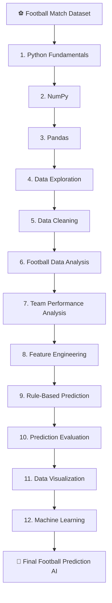

---

# 1️⃣ Python Fundamentals

Start the project using basic Python programming concepts.

### Tasks

Learn and use:

* Variables
* Data Types
* Lists
* Tuples
* Dictionaries
* Conditions
* Loops
* Functions
* File Handling

### Project Task

Create a small Python program that stores basic football information.

Example:

```python
team = {
    "name": "Manchester City",
    "matches": 10,
    "wins": 7,
    "draws": 2,
    "losses": 1
}
```

### Expected Result

The program should be able to calculate simple statistics such as:

```text
Team: Manchester City
Matches: 10
Wins: 7
Draws: 2
Losses: 1
Win Rate: 70%
```

### Roadmap

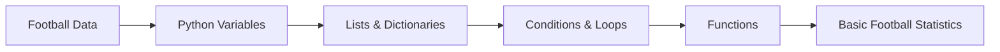

---

# 2️⃣ NumPy

Use NumPy for numerical calculations.

### Tasks

Calculate:

* Average goals
* Maximum goals
* Minimum goals
* Standard deviation
* Total goals
* Average shots
* Average possession

Example:

```python
import numpy as np

goals = np.array([2, 1, 3, 0, 2, 4])

print(np.mean(goals))
print(np.max(goals))
print(np.min(goals))
```

### Expected Result

The student should be able to calculate football statistics using NumPy.

### Roadmap

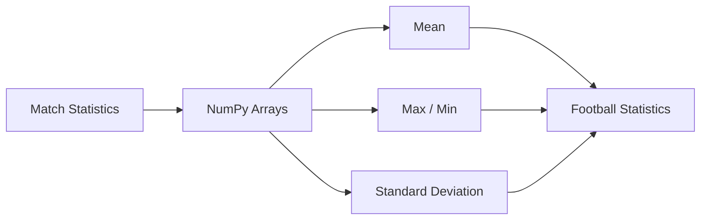

---

# 3️⃣ Pandas

Load the real football dataset using Pandas.

### Tasks

Learn:

* DataFrame
* Series
* Reading CSV
* Selecting columns
* Filtering rows
* Sorting
* GroupBy
* Aggregation

Example:

```python
import pandas as pd

df = pd.read_csv("data/matches.csv")

print(df.head())
print(df.info())
print(df.describe())
```

### Expected Result

The complete football dataset must be loaded and understood.

### Roadmap

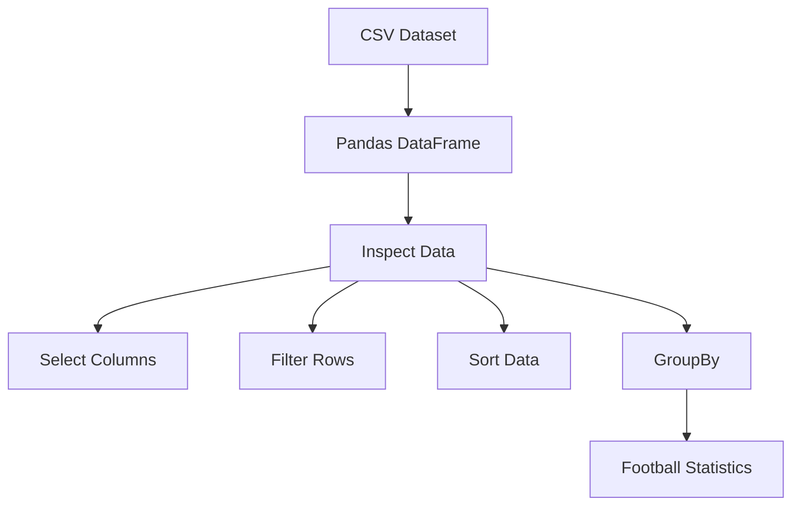

---

# 4️⃣ Data Exploration

Before making predictions, understand the dataset.

### Questions to answer

The student should investigate:

* How many matches exist?
* How many teams exist?
* Which team has the most wins?
* Which team has the most goals?
* What is the average number of goals?
* What is the average number of shots?
* What is the average number of corners?
* Which team has the best home performance?
* Which team has the best away performance?

### Roadmap

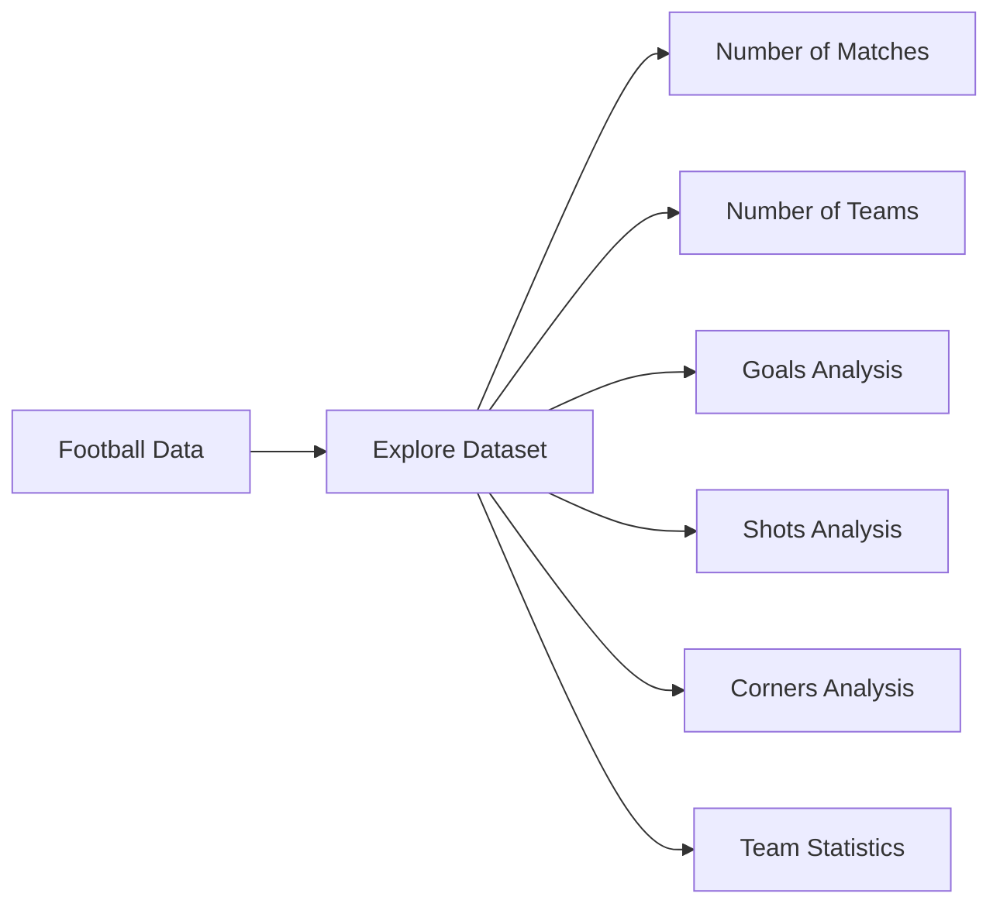

---

# 5️⃣ Data Cleaning

Real-world datasets may contain missing or incorrect values.

The student must identify and clean the data.

### Tasks

* Find missing values
* Remove or handle invalid values
* Check duplicate records
* Convert data types
* Standardize team names
* Select useful columns
* Verify the final dataset

Example:

```python
df.isnull().sum()
```

### Expected Result

A clean dataset ready for analysis.

### Roadmap

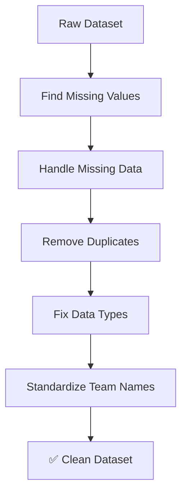

---

# 6️⃣ Football Data Analysis

Now analyze the cleaned football data.

### Analyze

* Goals
* Wins
* Draws
* Losses
* Shots
* Shots on Target
* Corners
* Fouls
* Yellow Cards
* Red Cards
* Possession

### Example

```text
Team: Arsenal

Matches: 20
Wins: 14
Draws: 4
Losses: 2

Goals Scored: 41
Goals Conceded: 19

Average Goals: 2.05
```

### Roadmap

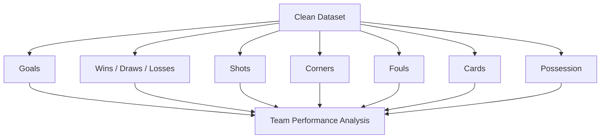

---

# 7️⃣ Team Performance Analysis

Build a performance profile for every team.

For each team calculate:

* Matches Played
* Wins
* Draws
* Losses
* Goals Scored
* Goals Conceded
* Goal Difference
* Average Goals
* Average Shots
* Average Corners
* Home Win Rate
* Away Win Rate

### Example

```text
Manchester City

Win Rate        : 72%
Average Goals   : 2.4
Goals Conceded  : 0.9
Home Win Rate   : 81%
Away Win Rate   : 64%
```

### Roadmap

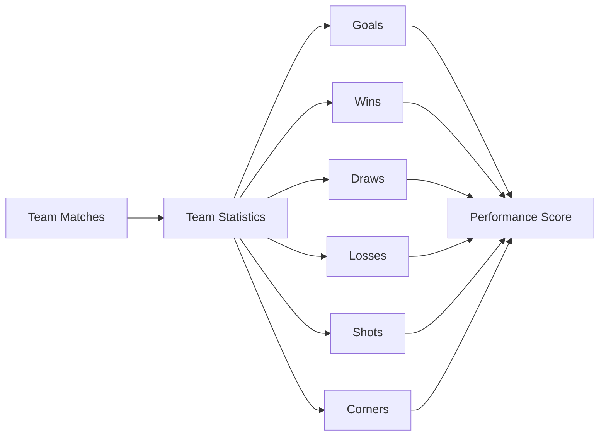

---

# 8️⃣ Recent Form Analysis

The prediction system should consider the team's recent performance.

For example, analyze the last 5 matches.

```text
Team A Recent Form

✅ Win
✅ Win
🤝 Draw
❌ Loss
✅ Win

Form Score = 80%
```

### Tasks

Calculate:

* Last 5 results
* Last 5 goals scored
* Last 5 goals conceded
* Recent win rate
* Recent average goals

### Roadmap

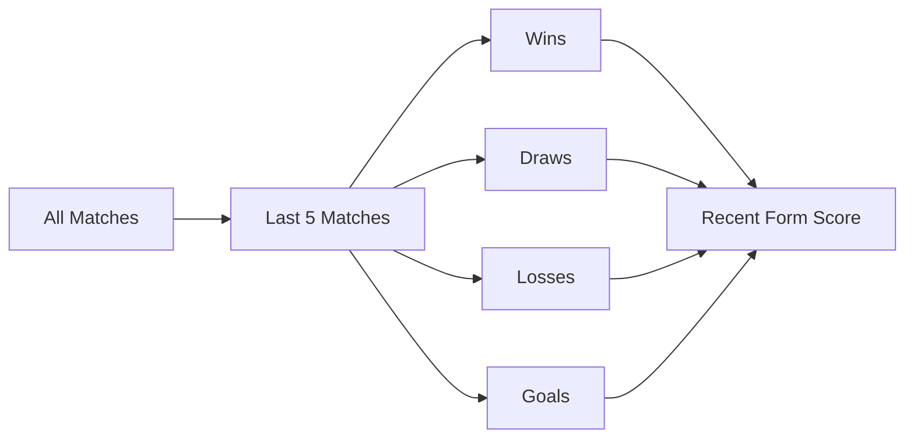

---

# 9️⃣ Feature Engineering

Create useful features for the prediction system.

Possible features:

```text
Home Win Rate
Away Win Rate
Recent Form
Average Goals Scored
Average Goals Conceded
Average Shots
Average Corners
Goal Difference
```

For example:

```text
Home Team Form        = 0.80
Away Team Form        = 0.60

Home Avg Goals        = 2.10
Away Avg Goals        = 1.30

Home Win Rate         = 0.75
Away Win Rate         = 0.55
```

### Roadmap

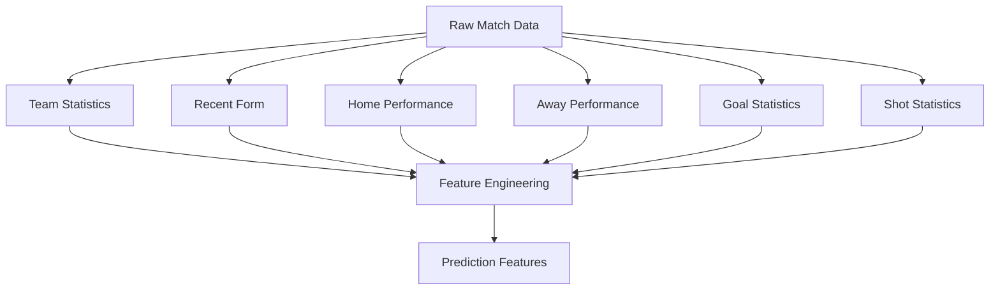

---

# 🔟 Rule-Based Match Prediction

Before Machine Learning, create a simple statistical prediction system.

The system should compare the two teams using their historical statistics.

### Example

```text
Manchester City vs Arsenal

Manchester City:
Form Score = 0.80
Home Win Rate = 0.75
Average Goals = 2.10

Arsenal:
Form Score = 0.65
Away Win Rate = 0.55
Average Goals = 1.70
```

The system calculates a simple prediction score.

Example result:

```text
Manchester City Win : 58%
Draw                : 24%
Arsenal Win         : 18%
```

### Roadmap

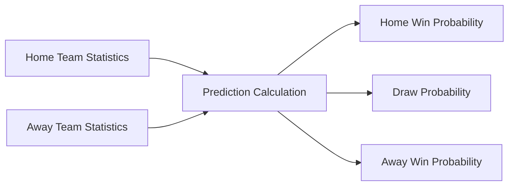

---

# 1️⃣1️⃣ Prediction Evaluation

The prediction must be tested against historical matches.

### Questions

* How many predictions were correct?
* How many were incorrect?
* What is the prediction accuracy?
* Which teams are easier to predict?
* Which situations produce incorrect predictions?

Example:

```text
Total Matches Tested : 200
Correct Predictions  : 118
Accuracy             : 59%
```

### Roadmap

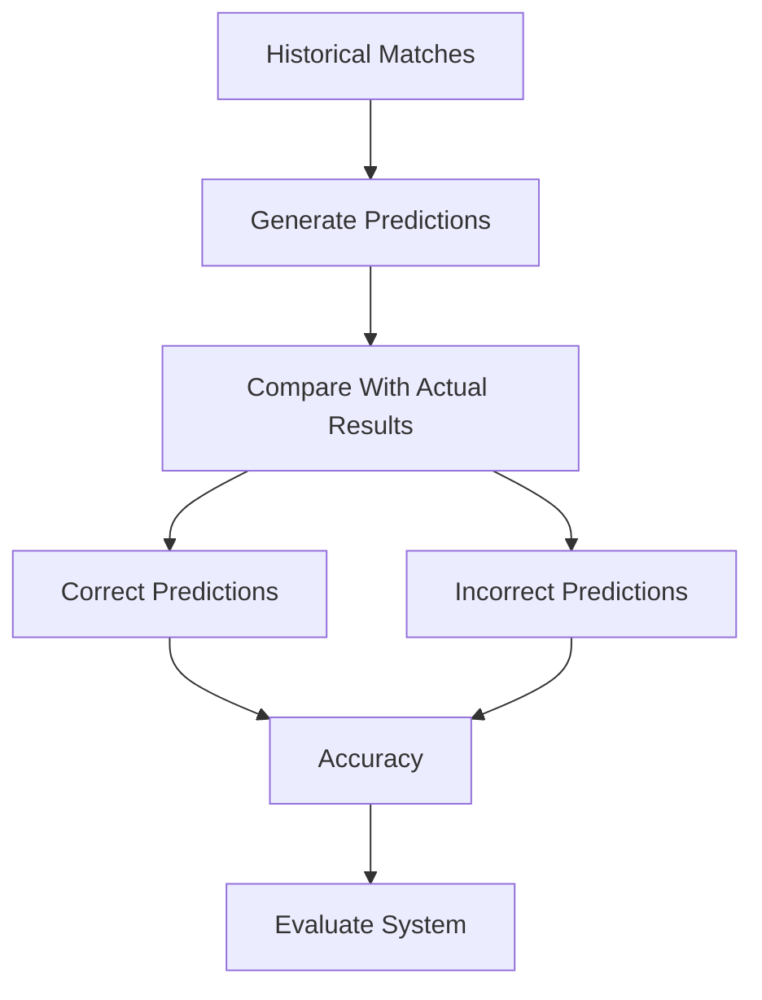

---

# 1️⃣2️⃣ Data Visualization

Create charts to understand football data.

The project should contain meaningful visualizations such as:

* Top scoring teams
* Top winning teams
* Average goals
* Home vs Away performance
* Team form
* Prediction results
* Prediction accuracy

Example:

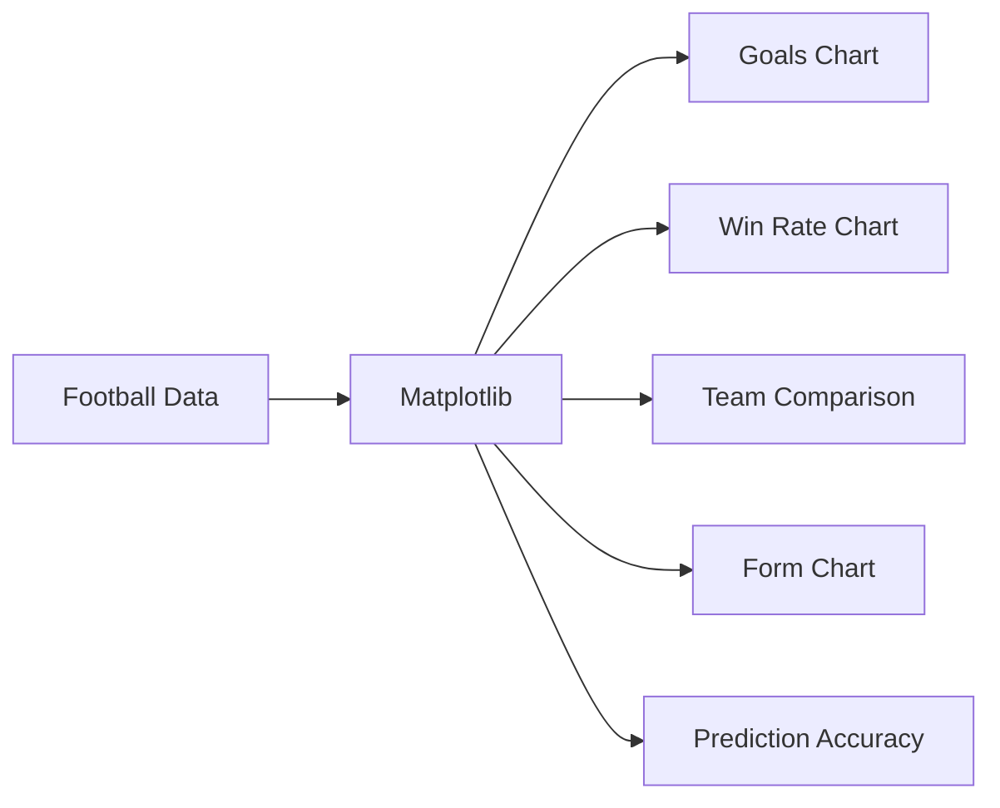

---

# 1️⃣3️⃣ Machine Learning

After completing the previous steps, upgrade the project to Machine Learning.

Use:

```text
Scikit-learn
```

Possible algorithms:

* Logistic Regression
* Decision Tree
* Random Forest

### Machine Learning Workflow

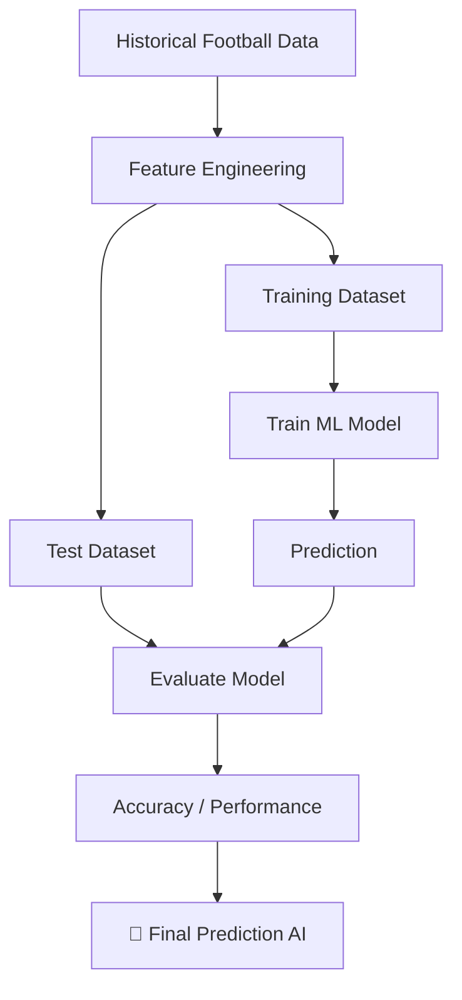

---

# 1️⃣4️⃣ Final System

The final version should allow the user to enter two teams.

Example:

```text
Home Team: Liverpool
Away Team: Chelsea
```

The system analyzes historical data and returns:

```text
⚽ Liverpool vs Chelsea

Home Win : 51%
Draw     : 27%
Away Win : 22%

Predicted Result:
Liverpool Win

Confidence:
Medium
```

### Final Architecture

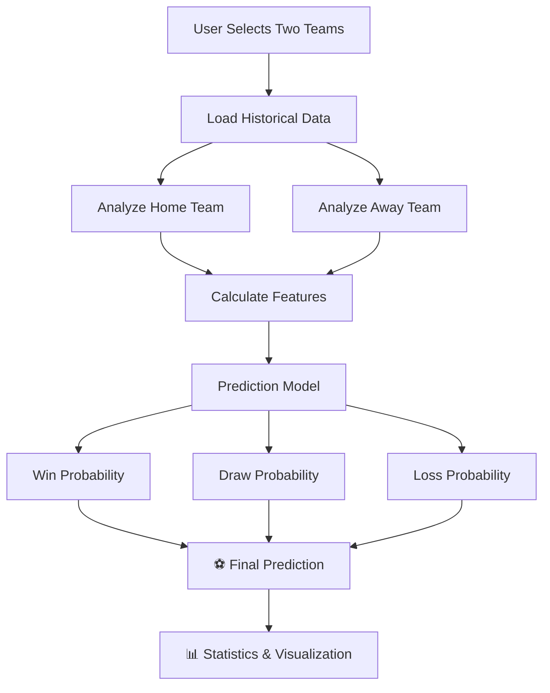

---

# 📁 Final Project Structure

```text
football-match-prediction-ai/
│
├── data/
│   └── matches.csv
│
├── notebooks/
│   ├── 01_python_basics.ipynb
│   ├── 02_numpy_analysis.ipynb
│   ├── 03_pandas_analysis.ipynb
│   ├── 04_data_exploration.ipynb
│   ├── 05_data_cleaning.ipynb
│   ├── 06_football_analysis.ipynb
│   ├── 07_team_performance.ipynb
│   ├── 08_feature_engineering.ipynb
│   ├── 09_prediction.ipynb
│   └── 10_machine_learning.ipynb
│
├── src/
│   ├── data_loader.py
│   ├── data_cleaning.py
│   ├── team_analysis.py
│   ├── feature_engineering.py
│   ├── prediction.py
│   └── model.py
│
├── results/
│   ├── charts/
│   └── predictions/
│
├── requirements.txt
└── README.md
```

---

# ✅ Final Requirements

The completed project must be able to:

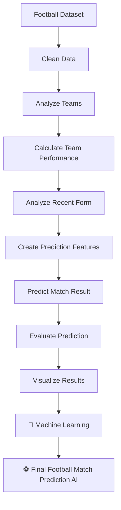

At the end of the project, the student should be able to explain **where the data came from, how the data was cleaned, how team statistics were calculated, how the prediction was made, how accurate the prediction was, and how the system could be improved using Machine Learning.**

---

# ⚠️ Important Note

This is an educational prediction system. Football matches contain uncertainty, and historical statistics cannot guarantee future results. The purpose of this project is to practice **Python programming, data analysis, statistics, and Machine Learning** through a real-world football problem.

---

# 🚀 Future Improvements

Future versions may include:

* Player-level statistics
* Injured players
* Expected Goals (xG)
* League standings
* Head-to-head statistics
* Live match data
* Advanced Machine Learning
* Deep Learning
* Web Dashboard
* REST API

---

## ⚽ Project Mission

> **Turn football data into intelligent predictions using Python and AI.**
